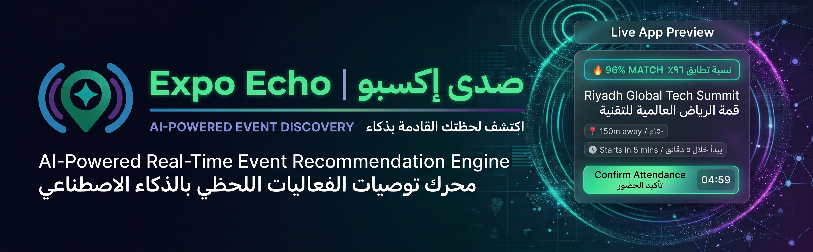

# 🌴 Expo Echo — AI-Powered Event Recommendation Engine

> Digital Challenge **1.3** — *"The difficulty of discovering and selecting suitable events
> when multiple activities are scheduled close together or overlap in time."*

Expo Echo turns the overwhelming Expo 2030 Riyadh programme into a **hyper-personalized feed**.
It scores every nearby event against the visitor's interests, location and available time,
shows a **Match %**, distance and a live countdown, and lets visitors confirm attendance and
get reminded **10 minutes before** the event starts.

---

## ✨ Features

| | |
|---|---|
| 🎯 **Match scoring** | Deterministic, explainable 0–100 score (interest 40 · proximity 25 · timing 20 · seats 10 · popularity 5) |
| ✨ **AI "why this?"** | A short personalized reason per card, generated via **OpenRouter** (Spring AI) with a template fallback so the demo never breaks |
| ⏱️ **Live countdowns** | "starts in 5 min" with an imminent highlight (≤ 15 min) |
| 📍 **Proximity** | Haversine distance + walking time; "150 m away" |
| 🔔 **Smart reminders** | Spring `@Scheduled` + **Server-Sent Events** → browser **Web Notifications** 10 min before start |
| ✅ **Instant booking** | Confirm/cancel attendance with live seat counts |
| 🗓️ **Calendar** | One-tap `.ics` download (add to any calendar) |
| 🗺️ **Simulation map** | Leaflet map of the Expo site; drag your marker to recompute distances (works anywhere, real GPS optional) |
| 🌐 **Arabic-first, bilingual** | Full AR (RTL) / EN UI with runtime switch |
| 🎨 **Expo 2030 brand** | Official palette & palm-leaf theme gradients |

---

## 🏗️ Architecture

Single deployable unit — **Spring Boot serves the compiled Angular SPA** (one URL, one QR, no CORS).

```
expo-echo-platform/
├─ frontend/                    Angular 21 (standalone, signals, zoneless)
│  └─ src/app/{core,shared,layout,features}
├─ src/main/java/org/fadhel/expoechoplatform/
│  ├─ domain/        Event, Category, Venue, Visitor, Booking, AppNotification
│  ├─ repository/    Spring Data JPA
│  ├─ service/       ScoringService, RecommendationService, AiReasonService,
│  │                 BookingService, NotificationService (SSE)
│  ├─ scheduling/    ReminderScheduler
│  ├─ web/           REST controllers + global error handler
│  └─ config/        Security, WebConfig (SPA fallback), AppProperties, DataSeeder
├─ Dockerfile                   node build → maven build → JRE run
└─ railway.json                 healthcheck / deploy config
```

**Stack:** Spring Boot 4.1 · Spring AI 2.0 (OpenRouter) · JPA · PostgreSQL (prod) / H2 (dev) ·
Angular 21 · Tailwind CSS v4 · Leaflet · ZXing (QR).

---

## 🚀 Run locally

**Prerequisites:** JDK 21+, Node 20+, npm.

### 1) Backend (port 8080, dev profile → in-memory H2 + seeded demo data)

```bash
./mvnw spring-boot:run
```

### 2) Frontend (port 4200, proxies `/api` → 8080)

```bash
cd frontend
npm install
npm start
```

Open <http://localhost:4200>.

### 3) Tests

```bash
./mvnw test                 # backend: scoring + end-to-end flow
cd frontend && npm test     # frontend
```

---

## 🔌 Environment variables

Copy `.env.example` and fill in as needed.

| Variable | Default | Description |
|---|---|---|
| `SPRING_PROFILES_ACTIVE` | `dev` | `prod` on Railway |
| `OPENROUTER_API_KEY` | – | OpenRouter key ([openrouter.ai/keys](https://openrouter.ai/keys)) |
| `OPENROUTER_MODEL` | `openai/gpt-4o-mini` | Any OpenRouter model id |
| `AI_ENABLED` | `false` | Set `true` to turn on AI reasons (needs the key) |
| `PGHOST` / `PGPORT` / `PGUSER` / `PGPASSWORD` / `PGDATABASE` | – | Provided automatically by the Railway Postgres plugin |
| `SITE_CENTER_LAT` / `SITE_CENTER_LNG` | Expo site | Center used for the simulated venue map |

> The app works **without** AI — scoring is deterministic and reasons fall back to templates.
> Set `AI_ENABLED=true` + `OPENROUTER_API_KEY` to add live AI wording.

---

## ☁️ Deploy to Railway (QR demo)

1. **Push to GitHub**
   ```bash
   git add . && git commit -m "Expo Echo" && git push
   ```
2. **Create a Railway project** → *Deploy from GitHub repo* → pick this repo.
   Railway detects the `Dockerfile` and builds frontend + backend automatically.
3. **Add PostgreSQL** → *New* → *Database* → *PostgreSQL*. Railway injects `PGHOST`, `PGPORT`,
   `PGUSER`, `PGPASSWORD`, `PGDATABASE` into your service.
4. **Set service variables** (Service → *Variables*):
   ```
   SPRING_PROFILES_ACTIVE=prod
   AI_ENABLED=true
   OPENROUTER_API_KEY=<your key>
   OPENROUTER_MODEL=openai/gpt-4o-mini
   ```
5. **Generate a public domain** → *Settings* → *Networking* → *Generate Domain*.
6. **QR**: open the app on your phone, go to **Profile → Share the app** — the built-in QR
   encodes the live URL. Or fetch one directly:
   `https://<your-domain>/api/qr?url=https://<your-domain>&size=512`
   (`/api/qr` is also usable in any slide/README.)

Health check: `GET /actuator/health`.

---

## 🎬 Live demo script (90 seconds)

1. Scan the QR → app opens in Arabic/RTL on the phone.
2. **Onboarding**: enter a name, tap **Technology + Art**, choose **30 minutes**, enable notifications → *Start exploring*.
3. The feed shows a card with a high **Match %**, e.g. **"starts in 5 min · 150 m away"** and an AI line
   *"Strongly matches your interest in Technology, just 150 m away and starts in 5 min."*
4. Tap **🗓️** to add to calendar, then **Confirm attendance** → toast + live seat count.
5. Open the **Map**, drag your marker → distances update; the nearest list re-ranks.
6. Wait ~10 s → the **reminder notification** fires (scheduler + SSE + Web Notification).
7. Switch to **Profile → Share** to show the QR again, or toggle **EN/AR** to show RTL/LTR.

---

## 🔗 API reference

| Method | Path | Purpose |
|---|---|---|
| `GET` | `/api/categories` | Expo theme categories (with brand gradients) |
| `GET` | `/api/config` | Site center, radii, reminder lead, AI flag |
| `POST` | `/api/visitors` | Create lightweight visitor profile |
| `PUT` | `/api/visitors/{id}` | Update interests / time / location |
| `GET` | `/api/recommendations?visitorId=&minutes=&radius=` | Personalized scored event cards |
| `GET` | `/api/events?within=` · `/api/events/{id}` | Event list / detail |
| `POST` / `DELETE` / `GET` | `/api/bookings` | Book / cancel / list |
| `GET` | `/api/notifications?visitorId=` | Reminder history |
| `GET` | `/api/notifications/stream?visitorId=` | **SSE** live reminders |
| `GET` | `/api/events/{id}/calendar.ics` | Calendar invite |
| `GET` | `/api/qr?url=&size=` | QR code PNG |

---

## 🎨 Brand

The UI is bilingual and swaps the logo automatically with the language:

- `frontend/public/ar-logo.png` — shown when the app is in **Arabic (RTL)**
- `frontend/public/en-logo.png` — shown when the app is in **English (LTR)**

Palette enhanced from the **Expo 2030 Riyadh** identity:

| Token | Hex | Use |
|---|---|---|
| `primary-green` | `#006C35` | Primary brand |
| `ai-teal` | `#08B0A0` | AI accents |
| `tech-purple` | `#47266C` | Technology |
| `arch-blue` | `#1E87BD` | Architecture |
| `match-gold` | `#FAB712` | Match score |
| `success-green` | `#4FB480` | Success |
| `alert-orange` | `#E8431B` | Alerts / imminent |

Gradients: `brand-underline` (`#47266C → #08B0A0 → #1E87BD`) and `logo-pin`
(`#006C35 → #08B0A0`). Surfaces stay light-balanced (`--bg-app #f5f7f9`), not pure white or dark.

Typography: Montserrat (Latin) + IBM Plex Sans Arabic (Arabic/RTL).
